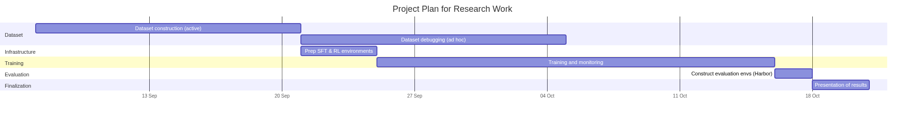

# CAD-QA: A Benchmark Verifying Geometry Reasoning over Complex Procedural CAD Programs

Maksym Riabov · 25194372 · Research in Computing · National College of Ireland

## Abstract

Large language models (LLMs) are increasingly proposed and demanded as CAD
design assistants, yet their comprehension of procedural geometry remains
too often incorrect: they generate functioning and correct-looking
code that fails with invalid geometry such as overlaps between
parts or simply incorrect geometry. We construct a
question-answering dataset from CadQuery programs, where each question requires
comprehending a complex CAD model --- finding relationships between boolean
operations, faces, vertices and edges, computing their volume, span or
location. Questions range from simple lookups to challenging high reasoning hop
questions with rich distractors, requiring chains of complex and correct reasoning.
We evaluate open-source LLMs in three harnesses --- without tools, with a NumPy shell, and with full CadQuery access --- measuring accuracy by reasoning hop count, task family, and LLM harness mode.
Expected contribution: a benchmark exposing
the multi-hop geometry reasoning gap in current Large Language Models

**Keywords:** multi-hop reasoning, procedural CAD, CadQuery, verifiable evaluation, LLM benchmark

## 1. Introduction

Large language models (LLMs) are increasingly proposed and demanded as CAD
designers and assistants (Zhang et al., 2026; Khan et al., 2024). Recent work targeted text-, image-
and mesh-to-CAD generation, and engineering documentation question answering
datasets, but LLMs still struggle with generation of useful, complex CAD models,
in particular with problems such as overlapping parts, impossible geometry (on top
of simple code correctness problems) (Khan et al., 2024; Doris et al., 2026) as
well as identifying the correct edge or face to select to build geometry upon; a
mistake in one CadQuery selector is destructive to the whole part.

Furthermore, LLMs are too often struggling with generating and coding of CAD models with
anything beyond box geometry in part due to lack of datasets that would have other geometry primitives (Elistratov et al., 2026); and even then, computing intersections between them requires
what appears to be an extraordinary amount of reasoning tokens compared to pure software/web app tasks. This is despite extensive mathematics
benchmarks for general 3D understanding. As such, the LLM approach is
presently infeasible even for simpler 3D modeling tasks.

To our knowledge, there isn't an open dataset which could reliably measure and allow improvement on
mathematical and spatial reasoning of models in domain of deriving and locating exact
parts, boolean operations (shapes), positions of objects, as well as truthful CAD code question answering beyond simple question.

The main research question is:

- How to improve the raw capabilities of LLMs on comprehending of CAD code?

The secondary research questions are:

- How to construct such a dataset that would improve models' reasoning on 3d code?
- Will scaling a synthetic training approach on such questions improve the actual reasoning on other datasets?
- Will reasoning be concise?

The main expected contributions are:

- A synthetic dataset and an open-source method of constructing the dataset to reliably drive mathematical reasoning on CAD models and the CAD ontology, such as vertices, faces, selectors
- The dataset can be reused for training of models for conciseness of reasoning on the tasks- as graphs are provided; one can train the LLM to follow the shortest/critical path necessary to achieve the result; aiding in evaluation of the LLM model on achieving correct intermediary steps faster.
- A dataset of progressively challenging and labeled tasks for 3D code & geometry reasoning aiding in curriculum learning.

The remainder of the document is structured as Literature review reviewing most relevant SOTA of the field, and our methodology and evaluation setting is explained in Section 3.

## 2. Literature Review

Presently, the relevant literature in the field of LLM and CAD modeling is split into three themes: reconstruction, geometry comprehension, general multi-hop reasoning benchmarks.

### 2.1 LLMs for CAD: Text-, Image- and Mesh reconstruction

The most prominent line of work in our field are Text2CAD, and Image2CAD, and Mesh2Cad tuned
reconstruction LLM models (Rukhovich et al., 2025). This is useful for the field of science as it
provides a means of generating substantial SFT-training data. Works such as "Text2CAD" (Khan et al., 2024)
generate CAD designs from text prompts; CADBench (Doris et al., 2026) is a benchmark advancing
generation of CAD models; BenchCAD (Zhang et al., 2026) is a fresh benchmark on programmatic CAD
that asks models to generate and edit CAD programs and to answer numeric questions about a given
CadQuery program. `cadrille` (Kolodiazhnyi et al., 2026), the program-evolution dataset (Elistratov et al., 2026), and CADENA (Kabisov et al., 2026) benchmarks test reconstruction of CadQuery models from parts. However, none are asking to e.g.
find a relationship between the two geometrical primitives which (by our
preliminary tests) leads to the LLM model emitting many more reasoning tokens than expected.

They build on datasets such as the program-evolution dataset, DeepCAD (Elistratov et al., 2026; Wu et al., 2021) which generate
geometry procedurally or via a LLM, which we build on too.

### 2.2 Benchmarks for Geometry Comprehension

DesignQA (Doris et al., 2025) is a dataset evaluating LLMs on engineering documentation e.g. PDFs to check whether models comply with engineering rules and standards; it is similar
in spirit in that it measures comprehension of parts, although it does not demand
multi-hop reasoning from CAD itself. Furthermore, the benchmark is about visual
reasoning, while our benchmark comprehends code only (visual is deferred to
future work).
SiT-Bench (Guo et al., 2026) and Real-3DQA (Ma et al., 2026) explicitly evaluate models' 3D comprehension abilities from text alone, without visuals. They are similar, but they do not evaluate or focus on CAD-specific geometry such as selectors, vertices, and boolean operations — only on text descriptions of scenes; nor are they working with code.

### 2.3 Verifiable Reasoning and Multi-Hop Benchmarks

Numerous verifiable reasoning/QA LLM benchmarks and datasets are present in
fields such as math, code, browsing (Wei et al., 2025; Li et al., 2025), but are absent from the yet-nascent field of CAD reasoning.

In the past, such synthetic benchmarks have allowed significant improvements and
served as a foundation for future work (Wei et al., 2022). With CAD geometrical reasoning being one
of the core requirements of correct modeling, this is arguably a critical
feature to address.

Remarkably, benchmarks in other fields aid curriculum learning by progressively labeling from simple to complex, which other works in the field of CAD modeling do not address the way
that we do.

CADTestBench (Mallis et al., 2026) can be notably close to ours — it verifies generated
CAD models against executable tests (CADTests), rather than grading them by visual similarity. Our dataset is, however, generated to
answer more complex questions and to support offline evaluation of prompts. It
is also a relatively simple benchmark, requiring at most 2-3 hops of reasoning,
whereas we propose up to ten.

### 2.4 Research Niche

As such, we survey the field and find that existing benchmarks evaluate models' reconstruction abilities, simple comprehension or question answering, but rarely dig deeper on the mathematical capabilities of models or deriving complex relationships between CAD parts in code. Nor they evaluate - or provide means to measure the shortest required reasoning for solving the problem. The problems are also relatively "clean" - one-step tasks that don't require discerning real-world noise or larger problems. These are three problems that we aim to improve on.

Table 1 compares CAD-QA with the closest prior work. The differentiators are reasoning depth (up to ten hops), a code-only setting, exact verifiable answers, and a hop-labelled curriculum.

| Work | Task | Input → output | Grading | Max reasoning hop count | Curriculum / critical path |
|---|---|---|---|---|---|
| DeepCAD (Wu et al., 2021) | CAD generation | command sequences → shape | reconstruction error | — | no |
| Text2CAD (Khan et al., 2024) | text-to-CAD generation | text → CAD sequence | similarity / validity | — | no |
| CAD-Recode (Rukhovich et al., 2025) | reverse engineering | point cloud → CadQuery code | code + geometry match | — | no |
| cadrille (Kolodiazhnyi et al., 2026) | reconstruction (RL) | image / points → CAD code | geometry match | — | no |
| program-evolution corpus (Elistratov et al., 2026) | corpus + reconstruction | CAD program → CAD program | geometry match | — | no |
| CADENA (Kabisov et al., 2026) | stepwise reverse engineering | shape → CAD code | stepwise match | — | no |
| CADBench (Doris et al., 2026) | generation benchmark | image / text → CAD program | geometric metrics | — | no |
| CADTestBench (Mallis et al., 2026) | test-verified text-to-CAD | text → CAD program | executable tests | 2–3 | no |
| DesignQA (Doris et al., 2025) | engineering-doc VQA | document → short answer | accuracy | — | no |
| SiT-Bench (Guo et al., 2026) | spatial intelligence | scene text → answer | accuracy | — | no |
| Real-3DQA (Ma et al., 2026) | 3D spatial relations | scene text → answer | accuracy | — | no |
| BenchCAD (Zhang et al., 2026) | generation, edit, numeric QA | image / CadQuery code → program / number | IoU, ratio accuracy | 1–2 | no |
| **CAD-QA (ours)** | code-only geometry reasoning | CadQuery code → structured answer | exact match | **0–10** | hop curriculum + critical path |

Table 1: Comparison of related CAD and geometry-reasoning benchmarks.

## 3. Research Methods & Specifications

### 3.1 Research Method

We construct a graph from a CAD program in three passes: we parse the program
into an Abstract Syntax Tree (AST) to recover operations and dataflow, and CadQuery code manipulations, executing it to measure geometry. Below is a representative
example; the task is to compute the Z difference between the topmost vertex of
the final part and the topmost vertex of the cylinder.

Code sample:

```py
import cadquery as cq
wp1 = cq.Workplane("XY")
wp2 = wp1.circle(2)           # cylinder circle
wp3 = wp2.extrude(5)          # cylinder extrusion
wp4 = cq.Workplane(           # define a point to build from
    cq.Plane(origin=cq.Vector(0, 0, 10))
)
wp5 = wp4.rect(4, 3)          # make a rectangle
wp6 = wp5.extrude(2)          # extrude a box
result = wp3.union(wp6)       # combined solid
```

From this we derive a graph such as:

```text
wp2 -> wp3 ... wp3 -> result
wp4 -> wp5 -> wp6 ... wp6 -> result
```

The question is:

> Given the CadQuery script below, what is the Z difference between the topmost
> vertex of the final part and the topmost vertex of the cylinder? Answer with
> exactly one finite number.

Derivation:

```text
z(top_vertex(result)) - z(top_vertex(wp3)) == 12 - 5 == 7
As such the answer has to be: 7
```

Notably, unlike many other CAD benchmarks which use realtime execution, our benchmark is meant to be generated and trained on _offline_, as we can precompute labels, positions, volumes and other
numerics ahead of time. This simplifies execution and verification thanks to the tabular data layout (and no need for setup of e.g. docker containers.)

We distinguish the following answer formats:

- **Entity references** — a source code variable name or unique source variable (`wp3`,
  `feature:wp3`, `path:wp2:point:6`, `selector:sel_all_faces_all`) for
  "which feature/face/edge/path-point …" questions.
- **Coordinates** — a `(x, y, z)` tuple for vertex position questions.
- **Numbers** — one finite value (graded to a 4-significant-figure tolerance):
  volumes, deltas, distances, vertex-position differences (such as `7`
  in the example above).
- **Integers** — exact non-negative counts: operations, faces, edges, vertices.
- **Booleans** — `true`/`false` for correctness/validity and point-membership answers (is the point in a volume/on a face?).
- **Enums and candidate choices** — one token from a fixed vocabulary or the
  presented candidates: coordinate frames (`XY`, `YZ`, `XZ`, …), point
  membership (`inside`, `outside`, `on_boundary`, `ambiguous`), or labels `A`, `B`, … (including CadQuery selector expressions) when a target is not readily nameable.
- **Structured JSON** — axis-aligned bounding boxes (`{"min": […], "max": […]}`)
  and CadQuery workplane-state snapshots.

We extract this CAD ontology:

- Nodes: sources, features, operations, parameters, workplanes, sketches, profiles, solids, faces, edges, vertices, axes, directions, points, centroids, centerlines, paths, selectors, measurements, material/void regions.
- Relations:
  - Temporal/dataflow: `before`, `after`, `input_to`, `combines`.
  - Parent/child CAD ontology node relationship: `created_by`, `modified_by`, `deleted_by`, `adds_material_to`, `removes_material_from`.
  - Construction: `uses_profile`, `used_by`, `parameter_of`, `selected_by`, `located_on`, `bounded_by`.
  - Measurement: `has_measurement`, `has_centroid`, `has_coordinate`, `has_normal`.
  - Geometry: `distance_to`, `nearest_tangent_to`, `parallel_to`, `not_parallel_to`, `perpendicular_to`, `orthogonal_to`, `coaxial_with`, `adjacent_to`, `opposite_to`, `contained_in`, `intersects`.
- Measurement scopes (prevent category errors):
  - `profile_intrinsic` — area, perimeter, centroid, local bounding box, edge/vertex counts.
  - `feature_application_effect` — signed volume delta, topology delta, circular-edge delta, bounding-box delta.
  - `entity_geometry`, `snapshot_state`, `relation_metric`.

When multiple objects are resolved (e.g., 8 vertices at the same Z height (a flat face parallel to the XY plane)), we further add classifiers like "select the 2nd highest on Y and lowest on X axes" to make the target unique (and further challenging to reason about).

The goal is to create an exhaustive CAD ontology extraction from which a set of truly complex reasoning questions can be derived.

We classify complexity by the number of reasoning hops:

- 0 hops: direct code lookup or mathematical lookup ("what's the length of `box1`?": 10).
- 1 hop: resolve one entity and read or calculate one metric ("A sphere has a center rightmost to some box with parameters (1,2,3). What is the label of the sphere operation?": `sphere1`)
- 2 hops: traverse one relation and read or compare a metric. (as above, but with added reasoning hops)
- 3~10 hops: BrowseComp (Wei et al., 2025)-style rows where obfuscated, distractor-rich questions and code require a successful answer to identify and calculate a number of variables.

### 3.2 Measuring complexity

Constrained by token costs, we avoid using frontier models, and instead benchmark our dataset on cost-effective (10-100x cheaper) models such as `deepseek-v4-flash`, `xiaomi-mimo-v2.5`, `NVidia NemoTron` super and other models for evaluation. We target at most 30% pass rate by these models; with task families being equally distributed in solve rates.

### 3.3 Improving models and proving learning

We will fine-tune LLM models using SFT & RL frameworks; in particular similar to how the program-evolution work trained its LLM models for better reconstruction, we will train models on more successful CAD mathematics using first SFT and then RL (DeepSeek-AI, 2025), first using rejection sampling (Shao et al., 2024), as well as in-place editing of the agent training trace for conciseness; later we will post-train the LLM model via frameworks like TRL or Unsloth on achieving better results on the task. We will show a graph that with training, the LLM model's solve rate improves.

After proving that the environment works and is correct through the API, we will post-train a small LLM model following that program-evolution work, whose authors have post-trained only a small — a 2-billion-parameter LLM model — to
do CAD reconstruction. E.g. an LLM model like Gemma4-E2B or Qwen3.5-2B will be used
owing to us attempting to save on compute expenses. If base models of this size
can solve these tasks with 10% success rates, this would be a good baseline. Our goal is to
improve their pass rates from 10% to 50-70%. RL is an expensive process, and as
such, and in our position, it is infeasible to train larger
models.

It could be that world modeling as done in InCoder-32B/InCoder-32B-Thinking
(Yang et al., 2026) will be used instead of SFT pipelines as it
has a higher potential to teach the LLM model more correct answers.

### 3.4 LLM harness modes

To evaluate baseline and then improve on capability of models - at triple of the compute cost - we propose to evaluate the LLM model under three LLM harness modes:

- `no_tools` LLM harness (reasoning only, where the LLM model computes mathematics internally),
- `numpy` LLM harness (a Python shell with NumPy, where the LLM model uses NumPy to compute the CAD model),
- `cadquery` LLM harness (a Python shell with CadQuery, which allows arbitrary CAD
operations to be executed; the LLM model is expected to use CadQuery to answer its
question, and a single successful tool call suffices - provided the LLM model gets it right).

The advantages of the three environments are as follows:

- To generalize the reasoning to three environments: the `no_tools` LLM harness requires more thinking and following through the objective and own noise to solve the problem correctly.
- NumPy environment requires understanding of 3D environment and modeling its geometry successfully without access to CAD; which is useful for generalizing to closed CAD environments such as SolidWorks or Autodesk Inventor, more commonly used in industry.
- The `cadquery` LLM harness allows the LLM model to answer in one shot by constructing a correct CAD operation. The research question is again conciseness, but also measuring the LLM model's ability to produce correct CAD code and reason toward it.

We will use Harbor coding environments with TerminalBench-equivalent environments (with access to only a Linux shell and file writing; the answers are submitted as files).

### 3.5 Ethical Considerations of the Research

The dataset and evaluation are exclusively synthetic and postprocessed from public secondary data — no human subjects, personal data, or human evaluation is involved; the advantage of the dataset is that it may enable models to reason faster on particular CAD data.
No risks are expected.

### 3.6 Project Plan

1. Dataset construction (2 weeks active + 2 weeks of debugging ad hoc)
2. Preparation of SFT and RL environments & setting training infrastructure — 3-4 days
3. Training and monitoring of progress.
4. Construction of evaluation environments (1-2 days — set up a Harbor environment)
5. Presentation of results (1-3 days)



## References

References follow the Harvard (author–date) style. The Australian CORE ranking is stated for each cited venue where one is available; where it is not (arXiv preprints, and journals after CORE discontinued journal rankings in 2022), the number of citations is quoted instead (Google Scholar where accessible, otherwise Semantic Scholar / Crossref / OpenAlex, which undercount Google Scholar). Counts as of August 2026.

- Zhang, L., Le, B., Akhtar, N., Lam, S.-K. and Ngo, T. (2026) 'Large Language Models for Computer-Aided Design: A Survey', *ACM Computing Surveys*, 58(9), pp. 1–39. doi: 10.1145/3787499. [No CORE rank, journal rankings discontinued 2022; ~4 citations, Crossref]
- Khan, M.S., Sinha, S., Sheikh, T.U., Stricker, D., Ali, S.A. and Afzal, M.Z. (2024) 'Text2CAD: Generating Sequential CAD Designs from Beginner-to-Expert Level Text Prompts', *Advances in Neural Information Processing Systems*, 37 (NeurIPS 2024). [CORE: A*; ~116 citations, Semantic Scholar]
- Doris, A.C., Sony, J.T., Nehme, G., Syla, E., Heyrani Nobari, A. and Ahmed, F. (2026) 'CADBench: A Multimodal Benchmark for AI-Assisted CAD Program Generation', arXiv preprint arXiv:2605.10873. Available at: <https://arxiv.org/abs/2605.10873>. [No CORE rank; new, ~0 citations]
- Doris, A.C., Grandi, D., Tomich, R., Alam, M.F., Ataei, M., Cheong, H. and Ahmed, F. (2025) 'DesignQA: A Multimodal Benchmark for Evaluating Large Language Models' Understanding of Engineering Documentation', *Journal of Computing and Information Science in Engineering*, 25(2), Art. no. 021009. doi: 10.1115/1.4067333. [No CORE rank; ~34 citations, Crossref]
- Guo, Z., Yang, Z., Li, Y., Zhang, X., Gao, W., Wang, J., Li, C., Liu, X. and Jian, P. (2026) 'Can LLMs See Without Pixels? Benchmarking Spatial Intelligence from Textual Descriptions', arXiv preprint arXiv:2601.03590. Available at: <https://arxiv.org/abs/2601.03590>. [No CORE rank; 3 citations, Google Scholar]
- Ma, X., Sun, T., Chen, S., Bhalgat, Y., Gu, J., Chang, A.X., Armeni, I., Laina, I., Peng, S. and Prisacariu, V.A. (2026) 'Do 3D Large Language Models Really Understand 3D Spatial Relationships?', *Proceedings of the International Conference on Learning Representations (ICLR)*. [Not in CORE database; 6 citations, Google Scholar]
- Zhang, H., Liu, K., Chen, M., Li, L., Yang, S., Peng, C. and Chen, H. (2026) 'BenchCAD: A Comprehensive, Industry-Standard Benchmark for Programmatic CAD', arXiv preprint arXiv:2605.10865. Available at: <https://arxiv.org/abs/2605.10865>. [No CORE rank; new, ~0 citations]
- Wei, J., Sun, Z., Papay, S., McKinney, S., Han, J., Fulford, I., Chung, H.W., Passos, A.T., Fedus, W. and Glaese, A. (2025) 'BrowseComp: A Simple Yet Challenging Benchmark for Browsing Agents', arXiv preprint arXiv:2504.12516. Available at: <https://arxiv.org/abs/2504.12516>. [No CORE rank; 530 citations, Google Scholar]
- DeepSeek-AI (2025) 'DeepSeek-R1: Incentivizing Reasoning Capability in LLMs via Reinforcement Learning', *Nature*, 645, pp. 633–638. doi: 10.1038/s41586-025-09422-z. [No CORE rank (multidisciplinary journal); ~918 citations, Crossref]
- Shao, Z., Wang, P., Zhu, Q., Xu, R., Song, J., Bi, X., Zhang, H., Zhang, M., Li, Y.K., Wu, Y. and Guo, D. (2024) 'DeepSeekMath: Pushing the Limits of Mathematical Reasoning in Open Language Models', arXiv preprint arXiv:2402.03300. Available at: <https://arxiv.org/abs/2402.03300>. [No CORE rank; 7557 citations, Google Scholar]
- Wu, R., Xiao, C. and Zheng, C. (2021) 'DeepCAD: A Deep Generative Network for Computer-Aided Design Models', *Proceedings of the IEEE/CVF International Conference on Computer Vision (ICCV)*, pp. 6772–6782. doi: 10.1109/ICCV48922.2021.00670. [CORE: A*; ~362 citations, Semantic Scholar]
- Elistratov, M., Barannikov, M., Ivanov, G., Khrulkov, V., Konushin, A., Kuznetsov, A. and Zhemchuzhnikov, D. (2026) 'CADEvolve: Creating Realistic CAD via Program Evolution', arXiv preprint arXiv:2602.16317. Available at: <https://arxiv.org/abs/2602.16317>. [No CORE rank; 3 citations, Google Scholar] <!-- dont-say: allow: bibliographic title -->
- Kolodiazhnyi, M., Tarasov, D., Zhemchuzhnikov, D., Nikulin, A., Zisman, I., Vorontsova, A., Konushin, A., Kurenkov, V. and Rukhovich, D. (2026) 'cadrille: Multi-modal CAD Reconstruction with Reinforcement Learning', *Proceedings of the International Conference on Learning Representations (ICLR)* (Oral). [Not in CORE database; ~1 citation, OpenAlex]
- Rukhovich, D., Dupont, E., Mallis, D., Cherenkova, K., Kacem, A. and Aouada, D. (2025) 'CAD-Recode: Reverse Engineering CAD Code From Point Clouds', *Proceedings of the IEEE/CVF International Conference on Computer Vision (ICCV)*. doi: 10.1109/ICCV51701.2025.00914. [CORE: A*; ~66 citations, Semantic Scholar]
- Kabisov, S., Savrasov, G., Elistratov, M., Rodriguez, A., Ignatiev, D., Gavrilov, N., Uzdenov, R., Boyko, A.I., Pasechnik, I., Konushin, A. and Kuznetsov, A. (2026) 'CADENA: Stepwise CAD Reverse Engineering', arXiv preprint arXiv:2608.00799. Available at: <https://arxiv.org/abs/2608.00799>. [No CORE rank; new, ~0 citations]
- Wei, J., Wang, X., Schuurmans, D., Bosma, M., Ichter, B., Xia, F., Chi, E., Le, Q. and Zhou, D. (2022) 'Chain-of-Thought Prompting Elicits Reasoning in Large Language Models', *Advances in Neural Information Processing Systems*, 35 (NeurIPS 2022), pp. 24824–24837. [CORE: A*]
- Li, K., Zhang, Z., Yin, H., Zhang, L., Ou, L., Wu, J., Yin, W., Li, B., Tao, Z., Wang, X., Shen, W., Zhang, J., Wu, X., Jiang, Y., Yan, M., Xie, P., Huang, F. and Zhou, J. (2025) 'WebSailor: Navigating Super-Human Reasoning for Web Agent', arXiv preprint arXiv:2507.02592. Available at: <https://arxiv.org/abs/2507.02592>. [No CORE rank; 43 citations, Google Scholar]
- Yang, J., Zhang, W., Wu, J., Cheng, J., Zheng, T., Xu, F., Gu, W., Jing, L., Du, Y., Li, J., Li, Y., Xing, Y., Hao, C., Tao, R., Gong, R., Liu, A., Li, Z., Tang, M., Lin, C., Chen, S., Zhao, W.X., Liu, X., Zhou, M., Dai, B. and Lv, W. (2026) 'InCoder-32B-Thinking: Industrial Code World Model for Thinking', arXiv preprint arXiv:2604.03144. Available at: <https://arxiv.org/abs/2604.03144>. [No CORE rank; 1 citation, Google Scholar] <!-- dont-say: allow: bibliographic title -->
- Mallis, D., Wang, M., Karadeniz, A.S., Ricci, E., Kacem, A. and Aouada, D. (2026) 'Text-to-CAD Evaluation with CADTests', arXiv preprint arXiv:2605.07807. Available at: <https://arxiv.org/abs/2605.07807>. [No CORE rank; 1 citation, Google Scholar]
